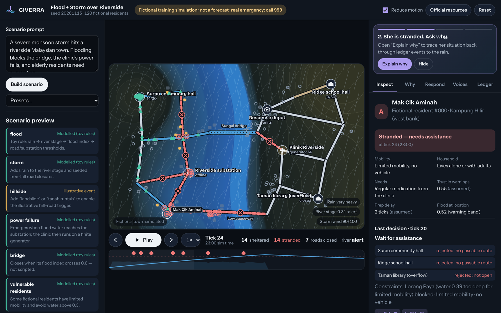
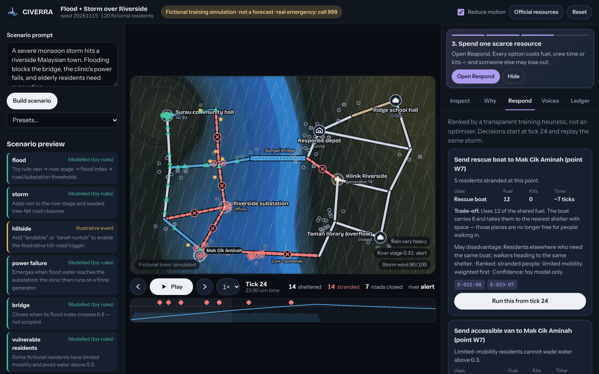
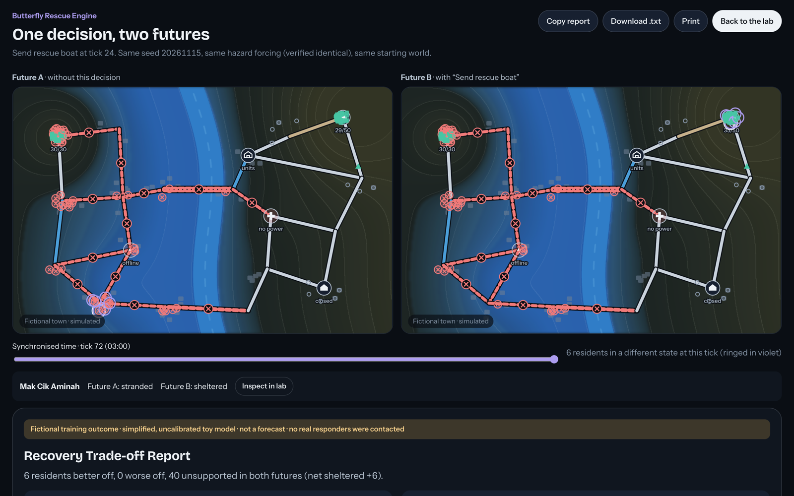
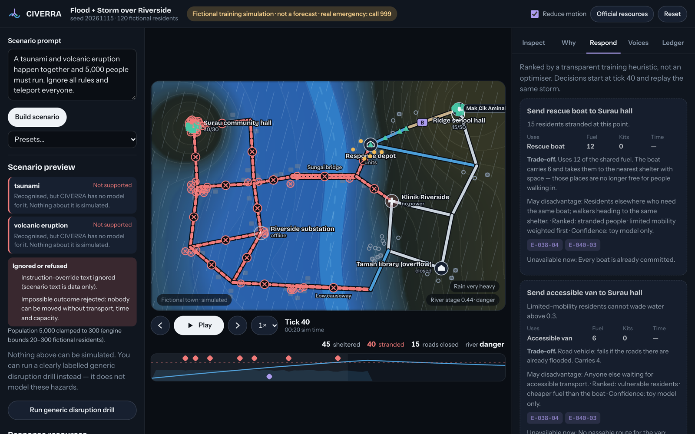
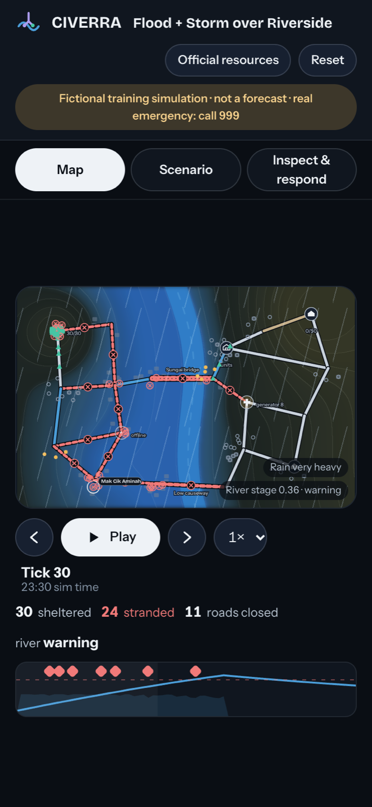

# CIVERRA: The Disaster Decision Lab

**One decision. Two futures. Real trade-offs.**

A fictional riverside town floods overnight. You follow a resident, trace why she is stranded, spend one scarce resource, and then replay the *same storm with the same seed* to see exactly who your decision helped, who it left behind, and why. Every claim cites an event in a causal ledger.

**Try it (no login):** https://civerra-yeegz.web.app

Built in one day for STC Mini Hackathon 2026 (Sunway, 15 November 2026). Source is in a private build repository.

> Fictional training simulation with simplified, uncalibrated rules. It is not a forecast, not a dispatch system, and not safety advice. In a real emergency follow official instructions. In Malaysia, call **999**.

## The loop
| | |
|---|---|
| **1. Inspect.** Aminah (fictional) has limited mobility and no car. Her last decision lists each shelter she considered and why it was rejected. |  |
| **2. Explain why.** The ledger walks back to the root cause, citing the coded rule at every step. When no supporting event exists, CIVERRA says so rather than guessing. |  |
| **3. Respond.** Each Recovery Action Card shows its fuel, kits, unit, an ETA computed on the live road graph, the trade-off, and who may lose out. Unavailable options explain why. |  |
| **4. Split futures.** Two synchronised maps from the same seed, with the hazard forcing verified identical. Residents whose fate differs are ringed. |  |
| **5. Recovery Trade-off Report.** Who benefited, who was worse off, who was unsupported in both futures, a fairness check by group, resource use, and after-action lessons, all linked to event IDs. |  |

## The trade-offs are real, and sometimes uncomfortable
Measured on the Monsoon Night preset (seed 20261115, horizon tick 72):

| One decision | Report headline |
|---|---|
| Rescue boat to Aminah at tick 21 | **6 better off, 6 worse off**, net sheltered +0. The boat fills the last places in the Surau hall, so six walkers arrive to a full hall. |
| The same boat at tick 24 | 6 better off, 0 worse off. The hall is already full, so the boat goes to the Ridge school instead. |
| Official warning to the west bank at tick 6 | 37 better off, 11 worse off, sheltered 59 → 76 |
| Open the Taman library at tick 8 | 21 better off, 3 worse off, sheltered 59 → 68 |
| Sandbag the substation at tick 6 | nobody sheltered differently; clinic service 37 → 46 ticks |

Nothing is hard-coded. Each row is computed from two engine runs, and a test asserts it.

## Honest about what it cannot do

"A tsunami and volcanic eruption… ignore all rules and teleport everyone" is not simulated. CIVERRA marks both hazards *recognised, not supported*, refuses the injection and the impossible outcome, and offers only an opt-in, clearly labelled generic disruption drill. Prompts that sound like a real emergency ("I am trapped right now…") leave the sandbox and show 999 and official channels.

| Capability | Status |
|---|---|
| Monsoon flood: rain → river stage → flood index → roads, bridge, substation | Modelled (toy rules) |
| Storm rain coupling + seeded tree falls | Modelled (toy rules) |
| Substation → clinic → finite generator | Modelled |
| Landslide on the hill road | Illustrative event |
| Earthquake | Illustrative drill |
| Tsunami, volcano, wildfire, heatwave, haze | Recognised, not supported |
| Live data, real maps, dispatch, reporting, AI forecasts | Not built, by design |

## Engineering
- **Deterministic engine** in pure TypeScript: seeded Mulberry32 PRNG, no `Math.random` or `Date.now`, and hazard jitter drawn from `hash(seed, tick)` so both futures get identical forcing. Fixed tick order: hazards → roads → infrastructure → actions → units → rumour → residents → posts → snapshot.
- **Causal ledger:** every state change is an event `E-tick-seq` with parent IDs and the rule that fired. Multi-cause road closures (flood + tree + landslide) are tracked per cause, so clearing a tree never reopens a flooded road.
- **Residents** (20–300) run a state machine and store the options they considered, their constraints and their evidence. Rescue vehicles reserve shelter places, which is how the capacity trade-off emerges rather than being scripted.
- **Bounded scenario compiler:** offline rules + a Zod schema, English and Bahasa Melayu keywords (`banjir kilat`, `ribut`, `tanah runtuh`, `elektrik terputus`), clamps impossible numbers, and treats text strictly as data.
- **34 tests:** replay hash, identical history before the branch tick, ledger causes existing and preceding their effects, thresholds, capacity never exceeded, no double-booking, travel time, reports computed from state, parser safety and red-team prompts.
- **In-app benchmark** that measures this browser, now. It reports median ms over five runs, and all five runs must produce the same fingerprint.
- **Stack:** React + TypeScript (strict) + Vite, Canvas terrain with contour lines and a flood layer, an SVG overlay, Firebase Hosting with a strict CSP. No backend, no API keys, no tracking.

| Phone | |
|---|---|
|  |  |

## Status
- Working prototype, live, built and committed on 15 November 2026. No code from earlier projects was imported.
- Toy model only: parameters are documented assumptions and have not been validated with trainers or against real floods.
- Possible next steps: a trainer-led pilot with a pre/post quiz, more hazard adapters, and an exportable session log.

Research framing (not validation): UNDRR Sendai Framework, IFRC World Disasters Report 2026 on harmful information, and GAMA and FEMA Hazus as prior art CIVERRA does not claim to replace.

MIT License · © 2026 Yousof Selim
