# CIVERRA: after the disaster, see what to do next

**Try it now, no login:** https://civerra-yeegz.web.app

**Demo video (2:48):** [media/CIVERRA_demo.mp4](media/CIVERRA_demo.mp4) · **Pitch deck (8 slides):** [media/CIVERRA_pitch.pdf](media/CIVERRA_pitch.pdf)

Built on 15 Nov 2026 for the STC Mini Hackathon. **Source code:** https://github.com/yeegz/Civerra

> MyDIMS tells you where the disaster is. CIVERRA tells you what to do next, in your own home.

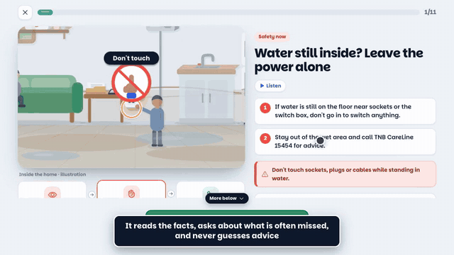

## What it is

CIVERRA is a recovery guide for Malaysian households, for the hours and days **after** a disaster. You say what happened in your own words. It works out the facts, draws a picture of your situation, and walks you through sourced recovery steps one at a time. When MET Malaysia or JPS issue a warning that affects you, the plan changes and it tells you what changed and why.

It covers floods, storms, landslides, house fires (once out), haze, limited earthquake aftermath, and recovery after an online scam or account takeover.

## Try it in two minutes

1. Open https://civerra-yeegz.web.app and tap **Flood at home** (or type your own message).
2. Tap **Build my scene** and go through a couple of steps.
3. Close the step view and look at **My day**, **Map**, **Updates** and **Report**.
4. Go back to the start (tap the logo) and try **Online scam** for a different kind of recovery.

## What it does

| | |
|---|---|
| **Your own words** | A message, read on the device, becomes a list of facts. Words like "trapped" or "sparks" go to the 999 screen first. |
| **One step at a time** | Each step shows the object in a picture of your home, a three-part how-to, numbered instructions, what not to do, and its source. |
| **Live updates** | MET Malaysia warnings and JPS river levels are checked every 5 minutes. A serious warning sounds an alert and re-builds the plan. |
| **Check-ins** | It asks if you're okay, more often while a safety step is open. "I need help" opens the 999 sheet. "I'm safe" goes to family through your own share sheet. |
| **Map** | Places for your situation (clinic, pharmacy, possible relief centre) with a walking route. Live location is opt-in and stays on the device. |
| **Report** | Losses, what's done and what's open, for JKM, an insurer or family. |
| **Set up once** | Your state and household, kept on the device, so the next case starts ready. |

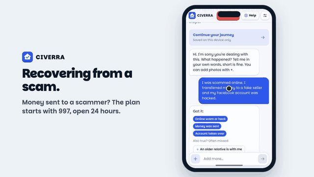

## Screens

| Tell it what happened | A recovery step | The next step and your home |
|---|---|---|
| 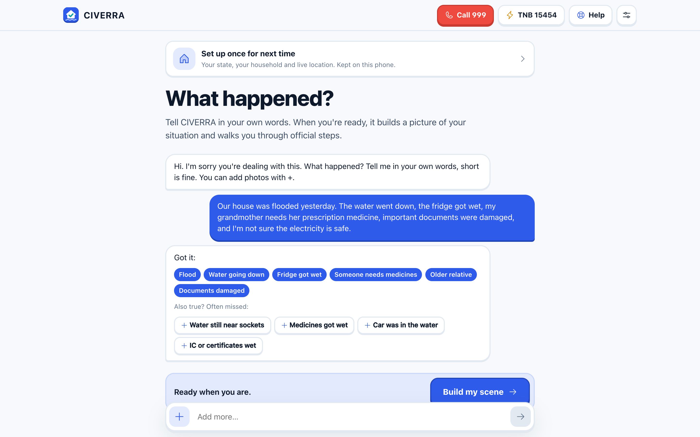 | 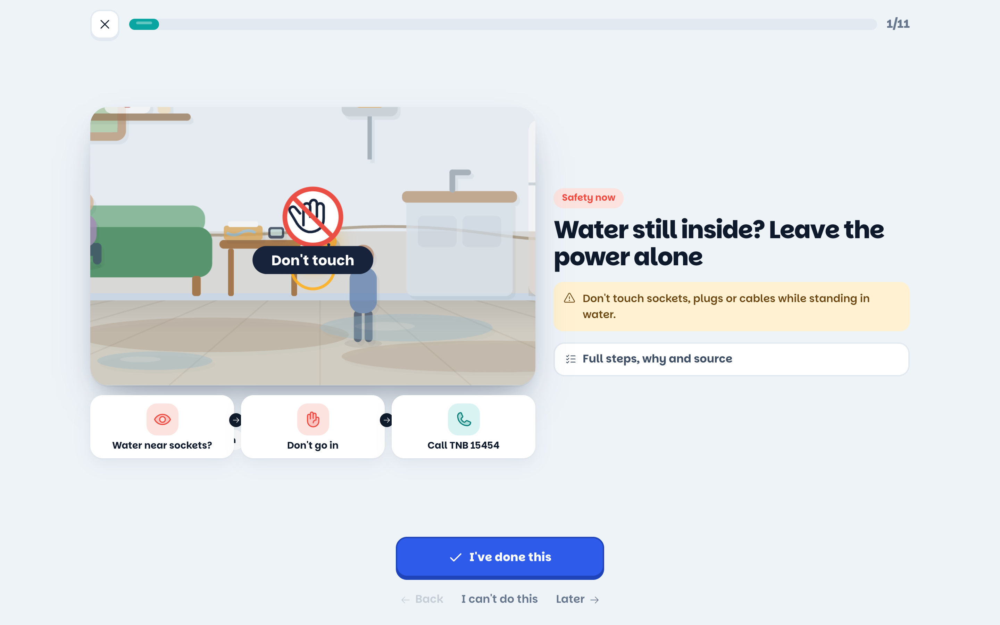 |  |

| My day | Map | Updates |
|---|---|---|
| 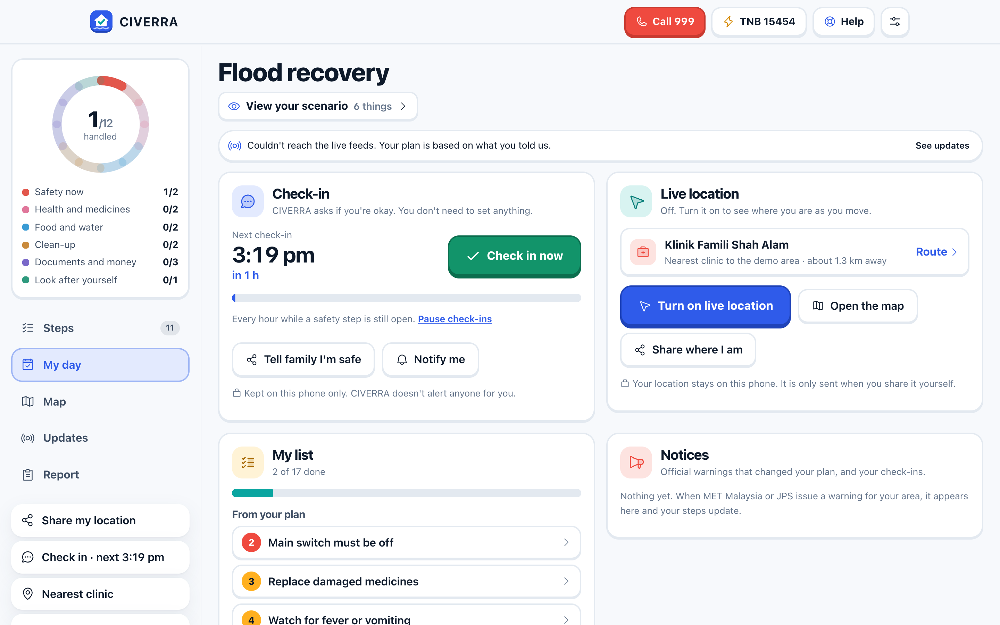 | 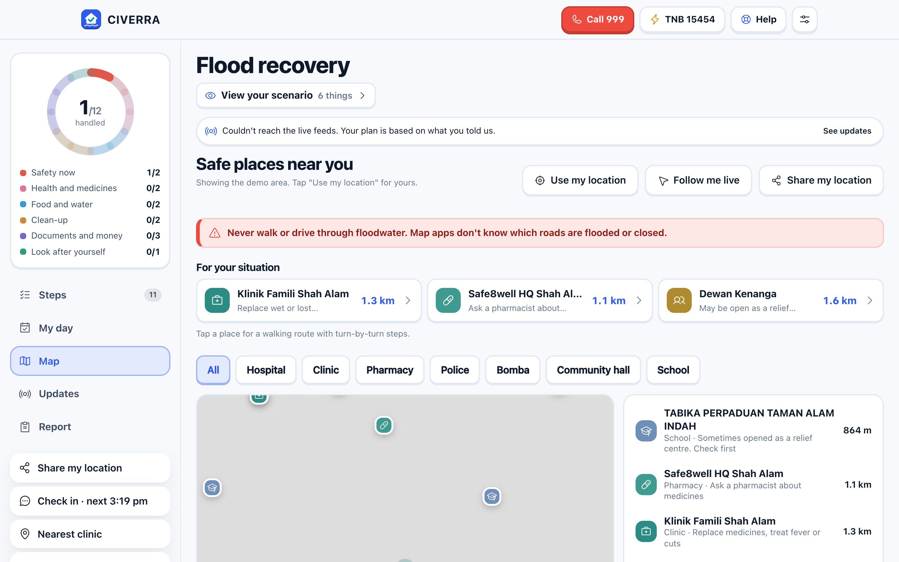 | 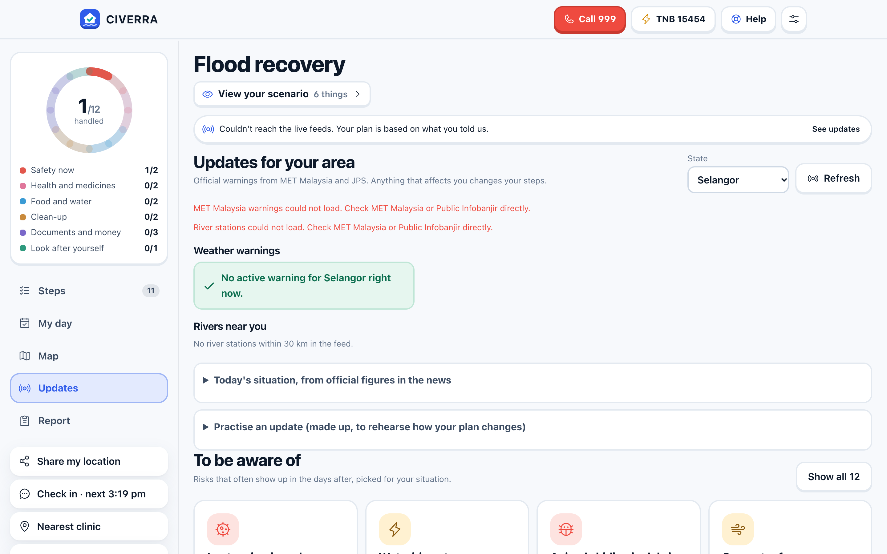 |

| Phone: steps | Phone: check-in | Phone: live location | Phone: my list |
|---|---|---|---|
| 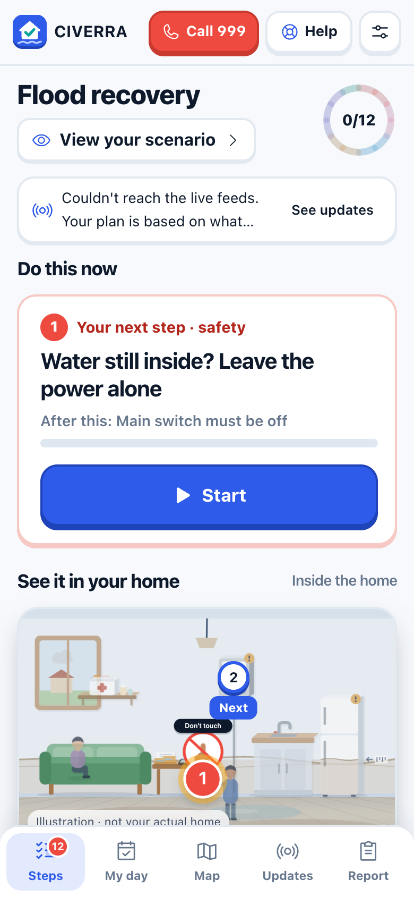 | 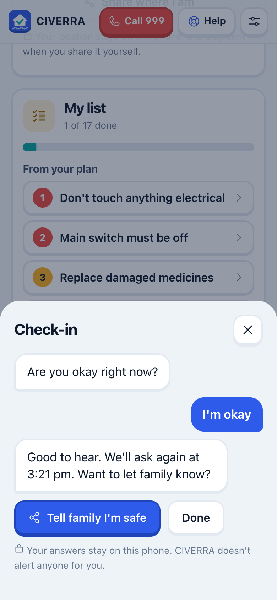 | 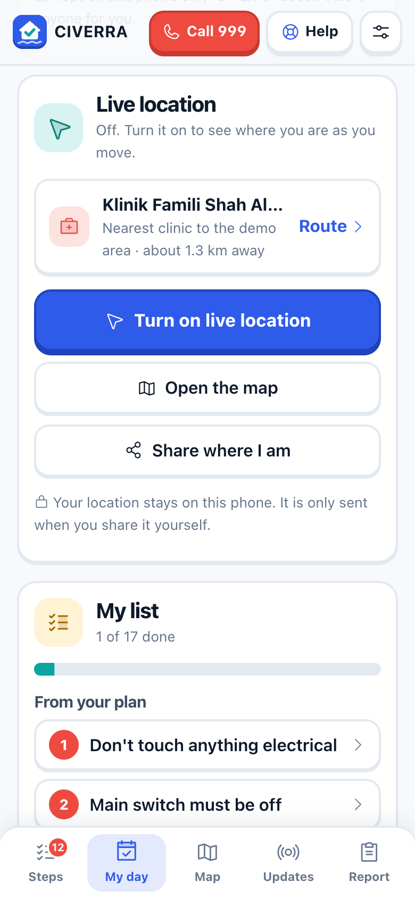 | 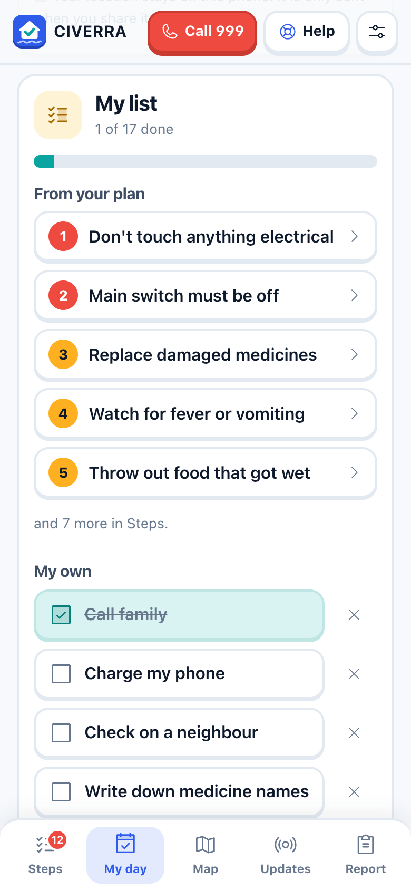 |

## How it was built

- **Front end:** React and TypeScript (Vite), hosted on Firebase Hosting. The scenes are hand-built SVG parts, not generated images.
- **Reading the message:** an on-device parser turns text into facts from a fixed list. Nothing personal leaves the phone.
- **The plan:** 31 fixed cards, each citing its source (TNB, KKM, JPN, NADMA/MyIBJKM, PIAM, PDRM, MyCERT, WHO, DOE, CDC and others), are selected and ordered from the facts.
- **Live data:** data.gov.my feeds for MET Malaysia warnings and JPS river stations; OpenStreetMap for places and walking routes.
- **Tests:** 53 automated tests, including 2,032 hazard, place and household combinations where every step must point at something drawn. A script walks all eight example scenarios to the end in a real browser.
- **Server (optional):** a small API that adds an AI reader and photo scan. It can only choose facts from the fixed list and never writes advice.

## Honest status

- **Working today:** everything in the table above, on the live link, on desktop and phone.
- **AI reader:** on. Messages are read on the device first, then by a server model that can only pick facts from a fixed list. IDs are removed and nothing is stored.
- **Not done:** recovery steps in Bahasa Melayu (MET warnings can be read in MET's own Malay text); testing with real users; push notifications when the app is closed.

## Safety

No accounts and nothing stored on a server. IC numbers, phone numbers and emails are stripped from messages. Danger goes to 999 first. Pictures are illustrations, not your home. CIVERRA does not replace emergency services, doctors, electricians or engineers, and it doesn't decide aid.

## Team

| Who | Role |
|---|---|
| Yousof | Coding and design |
| Salli | Slides, research and testing |
| Dana | Research and testing |

Screenshots and the video were recorded from the live site. MIT licence for this showcase.
