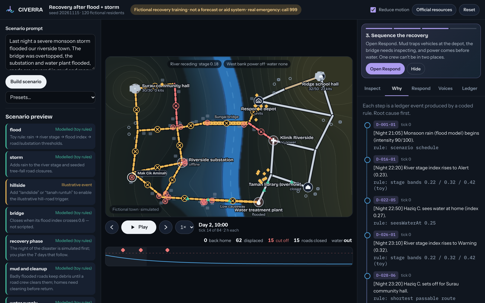
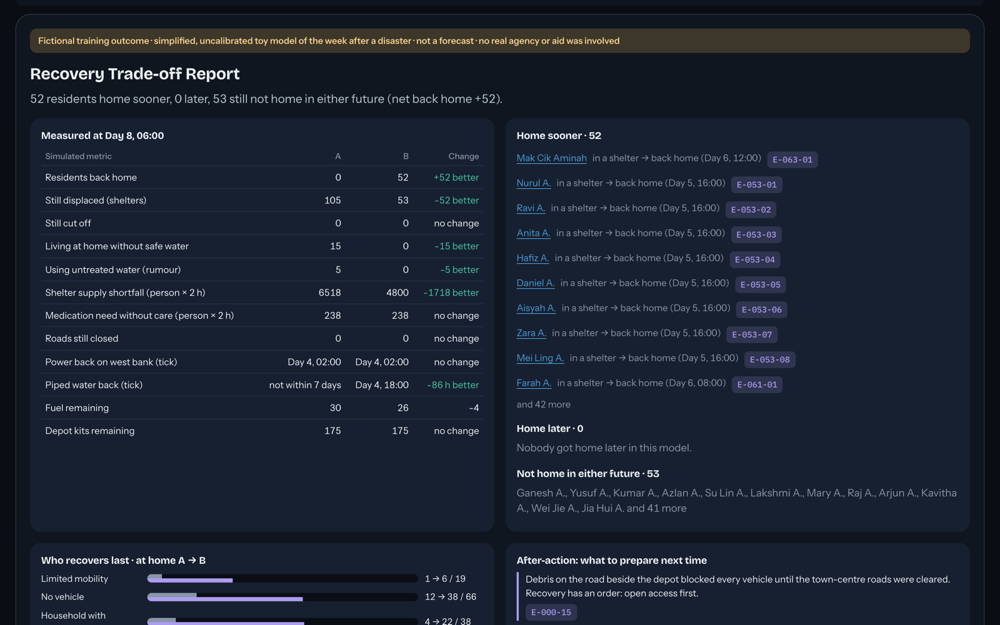
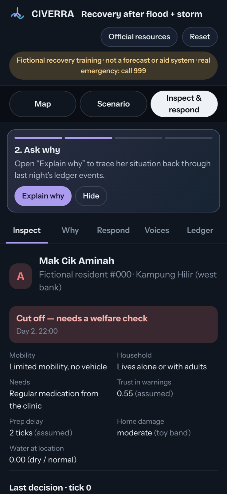

# CIVERRA: The Disaster Recovery Lab

**The flood is over. Recovery has just begun.**

CIVERRA simulates the night a disaster hit a fictional riverside town, then hands you the morning after:
- mud on the roads;
- a bridge to inspect;
- no power on the west bank;
- no clean water;
- shelters running out of supplies.

You sequence the first 7 days with one road crew, one power crew, one truck, engineers, a boat, a clinic van and volunteers. Then you replay **the same week with one decision changed** to see who got home sooner, who was left waiting, and why. Every claim cites an event in a causal ledger.

**Try it (no login):** https://civerra-yeegz.web.app

Built in one day for STC Mini Hackathon 2026 (Sunway, 15 November 2026). Source is in a private build repository.

> Fictional training simulation with simplified, uncalibrated rules. It is not a forecast, aid or dispatch system, and not safety, health or financial advice. In a real emergency follow official instructions. In Malaysia, call **999**.

## The loop
| | |
|---|---|
| **1. Inspect.** Each displaced resident has a return checklist: reachable, assessed, cleaned, power, water. Every blocker cites a ledger event, back to last night's flood. |  |
| **2. Explain why.** The causal chain links today's blocker to the night it happened. |  |
| **3. Sequence the recovery.** Cards show unit, fuel, kits, time and trade-off. Options that can't work yet say why: mud traps vehicles at the depot, the bridge needs an engineer, water needs power first. |  |
| **4. Recovery Trade-off Report.** Who got home sooner or later, who recovers last by group, service changes, resource use and after-action lessons, all linked to event IDs. |  |

## The trade-offs are real
Main preset, seed 20261115, measured at Day 8:

| Comparison | Result |
|---|---|
| No response | 0 residents back home, 80 displaced |
| Example 9-step plan | 52 back home; Mak Cik Aminah (fictional, limited mobility) home on Day 6 |
| …without restoring water | nobody gets home (−52) |
| …without volunteers | 36 fewer home, Aminah among them (she cannot clean alone) |
| Volunteers on the west bank vs Taman | 36 home sooner, 3 home later |

41 residents have major home damage. No 7-day decision brings them home, and CIVERRA says so.

## Honest about what it cannot do

- Aid payouts, insurance, post-flood disease, tsunami and volcano prompts are labelled **not supported**, never simulated.
- A synthetic "tap water is safe" rumour is checked against the ledger and marked **contradicted** while the water plant is down.
- Real-emergency language leaves the sandbox and shows 999.

## Engineering
- **Two deterministic engines** in pure TypeScript: the night of the flood (5-minute ticks) and the 7-day recovery (2-hour ticks). Same plan, same fingerprint. Both futures share an identical aftermath and river recession.
- **Causal ledger.** The night's events become `D-` evidence that recovery events cite. Closures are tracked per cause: flood, debris, inspection, tree, landslide.
- **Dependencies.** Debris blocks vehicles but not people on foot. The overtopped bridge needs an inspection. The water plant needs the substation. One crew per job.
- **Five return conditions** per resident, exposed as a checklist with evidence.
- **54 tests:** determinism, identical forcing, dependency gates, capacity, crew limits, the checklist, ledger integrity, reports computed from state, parser red-team prompts.
- **Stack:** React + TypeScript (strict) + Vite, Canvas terrain + SVG overlay, Firebase Hosting with a strict CSP. No backend, no API keys, no tracking.

| Phone | |
|---|---|
|  |  |

## Status
- Working prototype, live, built and committed on 15 November 2026. The recovery pivot was built the same day. No code from earlier projects was imported.
- Toy model only: parameters are documented assumptions, not validated with trainers or against real floods.
- Next: a trainer pilot with a pre/post quiz, a night replay on the map, a second rain band, and exportable debrief logs.

Research framing (not validation): UNDRR Sendai Priority 4 and the 2025 recovery-readiness priority actions; interdependent infrastructure restoration studies; evidence that disabled, older and car-less residents recover more slowly; IFRC WDR 2026 on harmful information.

MIT License · © 2026 Yousof Selim
