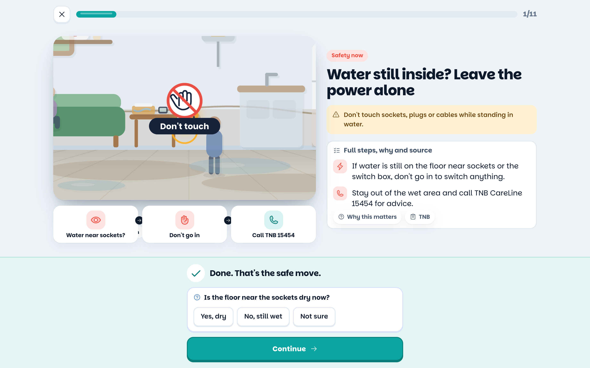
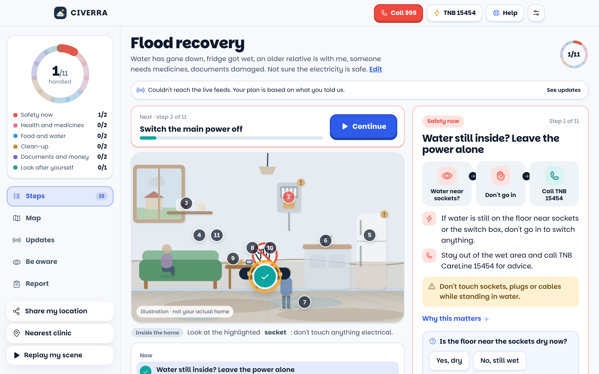
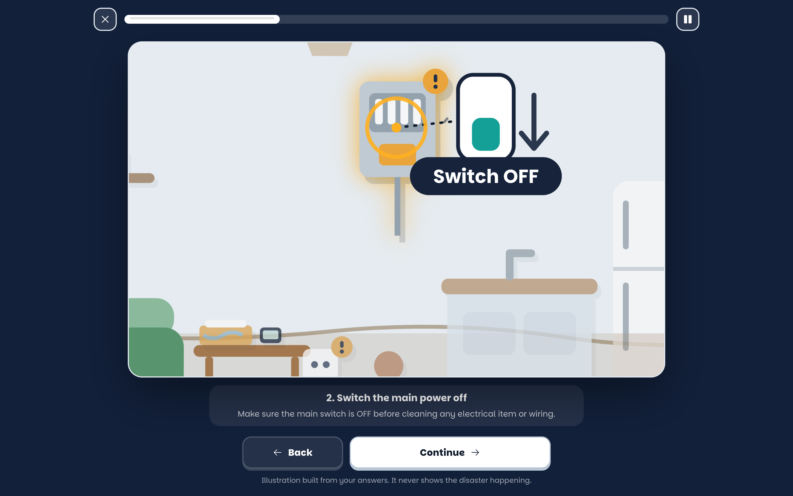
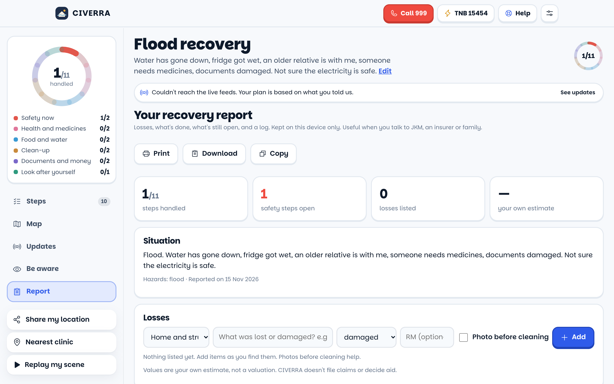
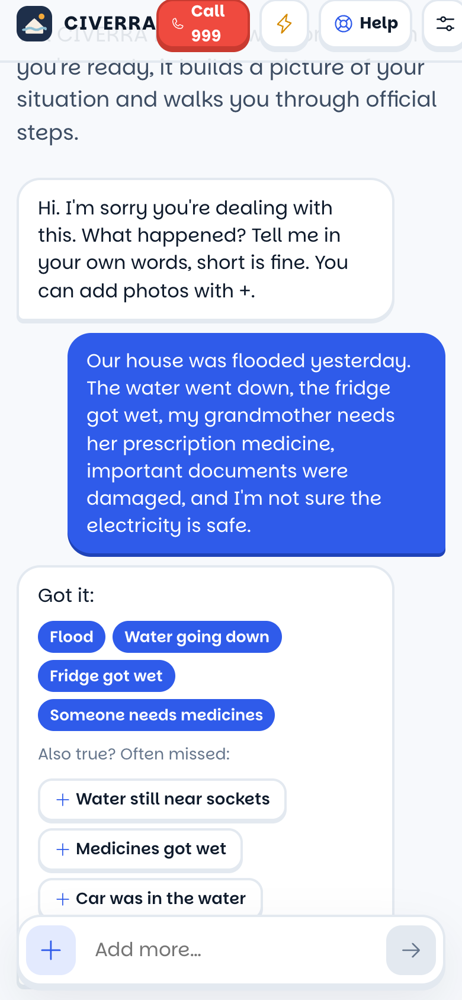
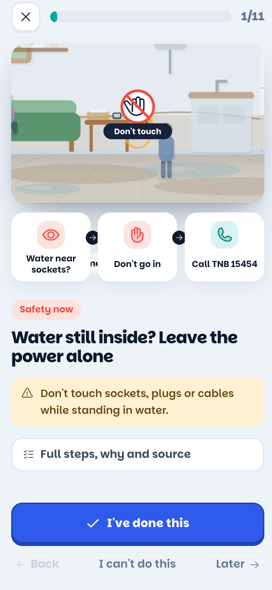
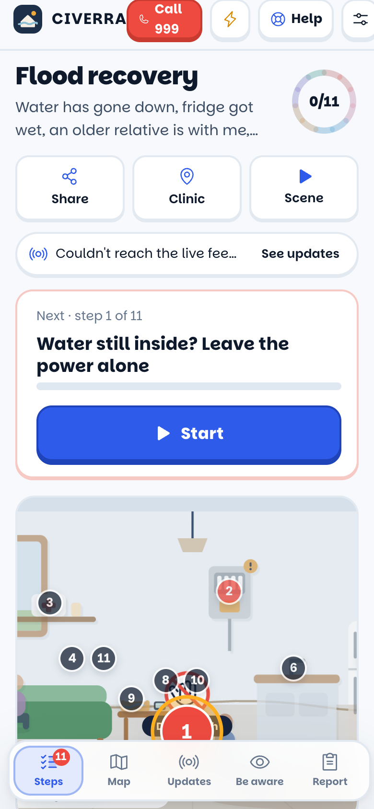

# CIVERRA: after the disaster, see what to do next

**Try it (no login):** https://civerra-yeegz.web.app

Built in one day for the STC Mini Hackathon (15 Nov 2026). This public repo shows the product; the source is private.

CIVERRA is a post-disaster recovery guide for Malaysian households. You tell it what happened in your own words, or add a photo. It builds an illustration of your situation from reusable building blocks and walks you through official, source-labelled steps one at a time. When MET Malaysia or JPS publish a warning that affects you, your plan and picture update and it tells you why.

> MyDIMS tells you where the disaster is. CIVERRA tells you what to do next, in your own home.

| Chat start | Lesson step | Done |
|---|---|---|
|  |  |  |

| Dashboard | Scene tour | Map |
|---|---|---|
|  |  |  |

| Updates | Be aware | Report |
|---|---|---|
|  |  |  |

| Phone: chat | Phone: lesson | Phone: dashboard |
|---|---|---|
|  |  |  |

## What's in it (honest status)
- **Works today:** chat with on-device reading (English + basic Malay); danger gate to 999; 26 human-written steps with sources (TNB, KKM, JPN, NADMA/MyIBJKM, WHO, DOE, PIAM, CDC, USFA); flood, storm, landslide, fire aftermath, haze and limited earthquake; four illustrated places; animated instruction graphics; lesson mode; scene tour; live MET warnings and JPS river levels; map with walking routes and today's relief centres; recovery report; one-shot location share. 36 automated tests, including every hazard × place combination.
- **Built but switched off:** a server that adds an AI reader and photo scan. Both can only pick from a fixed list of facts and never write advice.
- **Not done:** testing with real users; reviewed Malay translations; offline app mode.

## Safety
No accounts and no server storage. ID and phone numbers are stripped. Danger always goes to 999 first. Pictures are illustrations, not your home. CIVERRA does not replace emergency services, doctors, electricians or engineers, and doesn't decide aid.

Screenshots were taken from the live site with headless Chrome. MIT licence for this showcase.
